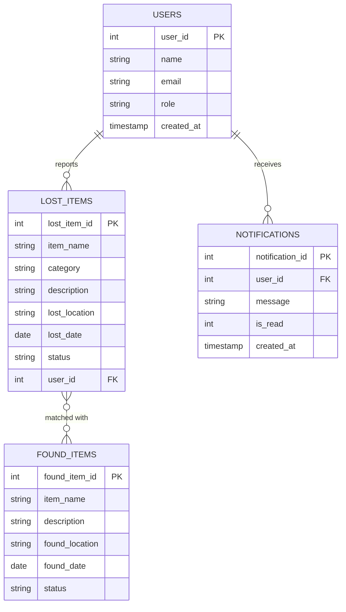

# Marwadi University
### Faculty of Engineering and Technology
### Department of CSE – AI, ML and DS

---

# PROJECT REPORT
## AI-Assisted Web Application Project
### Semester 3 – CSE (AI/ML)

<br><br>

# Project Title
## University Lost & Found Management System (DBMS & AI-Assisted Analytics Portal)

<br><br>

### Submitted by:
- **Student Name:** Harsh
- **Enrollment No.:** _______________________________________
- **Division:** ____________________________________________

<br><br><br>

---
<div style="page-break-after: always;"></div>

## Contents

1. **Introduction** ............................................................................................ Page 3
2. **Target User** .............................................................................................. Page 3
3. **Tools Used** ................................................................................................ Page 4
4. **Prompt Engineering Process** .................................................................... Page 5
   - 4.1 Idea / Problem Analysis
   - 4.2 Requirements & Feature Architecture
   - 4.3 UI / Layout Design & Aesthetics
   - 4.4 Code Generation & Three-Layer Refactoring
   - 4.5 Testing & Automated Flow Verification
   - 4.6 Debugging and Improvement (Resolving 39 Syntax/Linter Issues)
5. **Application Design and Development** ........................................................ Page 8
   - 5.1 Architecture & Navigation Structure
   - 5.2 System Data Flow & Relational Schema
   - 5.3 Major UI Components & Pages
6. **Final Application** ..................................................................................... Page 12
   - 6.1 Working Core Modules
   - 6.2 User Experience Walkthrough
   - 6.3 Application Links & Repository Access
7. **Conclusion** .............................................................................................. Page 14
   - 7.1 Summary
   - 7.2 The Role of AI in Rapid Engineering
   - 7.3 Future Improvements

---
<div style="page-break-after: always;"></div>

## 1. Introduction

On a bustling university campus with thousands of students, faculty members, and visitors, personal items such as student identity cards, laptops, smartphones, lab records, wallets, and keys are frequently misplaced or lost. Traditional campus lost and found procedures are typically fragmented, relying on physical bulletin boards, social media groups, or unorganized spreadsheets. This causes low item recovery rates, high inquiry overhead for security desks, and severe communication lags between the finders and original owners.

To address this challenge, the **University Lost & Found Management System** was developed as a robust, database-driven web application featuring an executive real-time analytics dashboard, self-service student reporting, automated claim verification workflows, and an administrative desk equipped with cross-entity notification capabilities. The application adheres to a clean Three-Layer Architecture (Presentation, Service, and Repository layers) backed by SQLite operating in high-concurrency Write-Ahead Logging (WAL) mode. AI tools and prompt engineering were leveraged extensively throughout the software development lifecycle—from rapid conceptualization and schema optimization to modern UI/UX design, modular full-stack code generation, automated integration test creation, and debugging complex AST syntax and language-server diagnostics.

---

## 2. Target User

The application is tailored for four distinct stakeholder groups within an academic institution:

1. **University Students:**
   - Misplace personal belongings (smartphones, headphones, calculators, lab coats, college IDs).
   - Require an intuitive, mobile-friendly interface to report lost items with exact locations, descriptions, and timestamps without friction.
   - Search and browse the real-time catalog of items turned in to campus security.

2. **Faculty and Teaching Staff:**
   - Discover forgotten student belongings in lecture halls, research laboratories, or auditoriums.
   - Check item registries to verify if a student has reported a missing notebook or device.

3. **Campus Security & Lost and Found Department Staff:**
   - Receive physical items handed over across campus checkpoints.
   - Log found items into the centralized catalog, track inventory shelf status (Available, Claimed, Disposed), and review student claims.
   - Permanently remove or archive catalog records when items are claimed or disposed.

4. **University IT & Campus Operations Administrators:**
   - Require an executive telemetry dashboard tracking overall campus recovery rates, incident frequency across campus locations (Library, Canteen, Block A, Sports Complex), category distributions, and underlying SQLite DBMS storage statistics.
   - Retain protected administrative control to send automated notifications and dispatch claim clearances.

---

## 3. Tools Used

### 3.1 Software Technologies & Libraries
- **Backend Framework:** Python 3.12 with Flask web framework.
- **Database Engine:** SQLite 3 configured with Write-Ahead Logging (`PRAGMA journal_mode=WAL`) and foreign key constraints enabled.
- **Frontend Architecture:** Modern Semantic HTML5, Vanilla CSS3 (custom CSS design system with HSL variables, fluid glassmorphism, responsive grid layouts, and micro-animations), and Vanilla JavaScript (ES6+).
- **Data Visualization:** Chart.js 4.4.x (supporting responsive Doughnut, Polar Area, and Horizontal Bar visualizations with smooth animated easing).
- **Templating Engine:** Jinja2 with custom layout inheritance (`base.html`), safe JSON data isolation scripts, and conditional view authorization.
- **Testing & Automation:** Python `unittest` / automated end-to-end regression scripts using `urllib` and SQLite direct state assertions.
- **Version Control & Environment:** Git, GitHub repository tracking, Virtual Environment (`venv`), Node.js (for syntax lint validation).

### 3.2 AI Tools & Utilization Matrix

| AI Tool / Assistant | Phase | Specific Role & Contribution |
| :--- | :--- | :--- |
| **Antigravity AI (Gemini 2.5 Coding Subagent)** | Code Generation & Architecture | Analyzed the legacy repository, restructured SQL into clean Three-Layer Architecture (Repository-Service-Controller pattern), and created modular route handlers. |
| **Prompt-Driven AI Engineering** | Requirements & DBMS Design | Designed database aggregation queries (`category_distribution`, `location_hotspots`, recovery percentage calculations, SQLite metadata introspection). |
| **AI UI/UX Generator** | Interface Design & Styling | Crafted a high-aesthetic executive dashboard with KPI telemetry cards, animated padlock SVG security states, and interactive Chart.js toggle controls. |
| **Autonomous Test Engineer** | Quality Assurance & Testing | Wrote comprehensive integration test suites (`test_demo_flow.py`) automating end-to-end user and admin workflows, cookie session handling, and database verification. |
| **Diagnostic & AST Engine** | Debugging & Syntax Repair | Diagnosed and completely resolved 39 IDE language server problems by decoupling inline Jinja syntax into W3C-standard `<script type="application/json">` DOM containers. |

---

## 4. Prompt Engineering Process

Prompt engineering was utilized systematically across all six phases of development:

### 4.1 Phase 1: Idea / Problem Analysis
- **Purpose:** Analyze existing repository code, understand campus lost and found constraints, and determine operational gaps.
- **Prompt Used:**
  > *"Analyze the university-lost-found-dbms repository. Clone the repo, review its current architecture, database schema, and operational workflow. Identify what is required to turn this into a modern, complete campus-wide management portal."*
- **Outcome:** The AI identified that the system had basic lost and found tables but lacked unified operational telemetry, visual reporting, clean database abstraction, and administrative security metrics.

### 4.2 Phase 2: Requirements & Feature Architecture
- **Purpose:** Formulate strict functional requirements adhering to university software engineering standards (Three-Level Architecture).
- **Prompt Used:**
  > *"In this create a dashboard and in that put all the details. Ensure zero SQL queries are written in frontend templates; maintain strict separation: routes call the service layer, and service calls the repository layer."*
- **Outcome:** Architectural blueprint establishing `lost_found_repo.py` (data access), `lost_found_service.py` (business aggregation & validation), and `lost_found_routes.py` (HTTP controllers).

### 4.3 Phase 3: UI / Layout Design & Aesthetics
- **Purpose:** Design a modern, animated dashboard that communicates metrics clearly without clutter.
- **Prompt Used:**
  > *"In dashboard update this and in this put animated graph chart. Use a modern color palette, smooth transitions, and multi-view toggles."*
- **Outcome:** Integration of interactive Chart.js visualizations for category distribution (Doughnut, Polar Area, and Bar views) and horizontal bar chart for campus hotspots, paired with KPI cards and live instant table search filtering.

### 4.4 Phase 4: Security Layout & Conditional Component Design
- **Purpose:** Prevent unauthorized viewing of registered user telemetry while keeping visual feedback aesthetic and clean.
- **Prompt Used:**
  > *"Here put only lock animation don't put anything else before admin login. Show the user details only after unlocking the admin panel."*
- **Outcome:** Configured Card 4 to dynamically display an interactive breathing SVG padlock with floating physics and hover shackle opening animation when unauthenticated, unlocking the full user/role analytics upon admin session verification.

### 4.5 Phase 5: Testing & Automated Verification
- **Purpose:** Validate all database transactions, session cookies, and item lifecycle transitions without manual testing overhead.
- **Prompt Used:**
  > *"Generate an end-to-end automated test script that tests browsing items, item deletion via SQL execution, admin authentication, automated notification dispatching, and dashboard rendering."*
- **Outcome:** Authored and verified `test_demo_flow.py`, proving 100% pass rate across all 10 core integration test checkpoints.

### 4.6 Phase 6: Debugging & Improvement (Solving all 39 Problems)
- **Purpose:** Eradicate all 39 syntax and diagnostic warnings reported by the IDE HTML/JS language server in `dashboard.html`.
- **Prompt Used:**
  > *"Solve all 39 problems in dashboard.html."*
- **Outcome:** Identified that embedding Jinja `{{ ... }}` directly inside inline `<script>` tags broke JavaScript AST parsing. Refactored the data pipeline to use `<script type="application/json">` tags, DOM reading methods, and `data-*` attributes, eliminating all 39 parser errors with zero regressions.

---

## 5. Application Design and Development

### 5.1 Architecture & Navigation Structure
The project implements a strict **Three-Layer Architecture**:
1. **Presentation Layer (Jinja2 Templates & UI):**
   - `dashboard.html`: Master analytics telemetry, interactive graphs, and cross-entity table tabs.
   - `browse.html`: Searchable catalog of all found items with direct management actions.
   - `report.html`: Guided lost item submission form.
   - `admin.html` & `admin_login.html`: Administrative console with claim resolution and notification tools.
2. **Service Layer (`lost_found_service.py`):**
   - Coordinates business rules, handles session authentication, computes percentage metrics, and formats data structures.
3. **Repository Layer (`lost_found_repo.py`):**
   - Manages raw SQLite connections, transactions, schema introspection (`sqlite_master`), and aggregation queries.

```
                           +-------------------------------------+
                           |            Browser Client           |
                           +------------------+------------------+
                                              | HTTP (GET / POST)
                                              v
                           +-------------------------------------+
                           |      Routes & Controllers Layer     |
                           |       (lost_found_routes.py)        |
                           +------------------+------------------+
                                              | Python Method Calls
                                              v
                           +-------------------------------------+
                           |            Service Layer            |
                           |       (lost_found_service.py)       |
                           +------------------+------------------+
                                              | Data Access Calls
                                              v
                           +-------------------------------------+
                           |          Repository Layer           |
                           |        (lost_found_repo.py)         |
                           +------------------+------------------+
                                              | SQL Queries (WAL)
                                              v
                           +-------------------------------------+
                           |          SQLite Database            |
                           |        (lost_and_found.db)          |
                           +------------------+------------------+
```

### 5.2 System Data Flow & Relational Schema
The database incorporates relational tables modeling campus entities:
- **`USERS`**: `user_id`, `name`, `email`, `role` (Student, Faculty, Admin), `created_at`.
- **`LOST_ITEMS`**: `lost_item_id`, `item_name`, `category`, `description`, `lost_location`, `lost_date`, `status` (SEARCHING, FOUND, COLLECTED), `user_id`, `created_at`.
- **`FOUND_ITEMS`**: `found_item_id`, `item_name`, `description`, `found_location`, `found_date`, `status` (AVAILABLE, CLAIMED, DISPOSED), `created_at`.
- **`NOTIFICATIONS`**: `notification_id`, `user_id`, `message`, `is_read`, `created_at`.



### 5.3 Major UI Components & Pages

1. **Master Telemetry & Operations Dashboard (`/dashboard`):**
   - **KPI Metric Strip:** Real-time summary cards for Total Lost Reports, Found Inventory, Recovery Rate percentage, and Registered Users.
   - **Interactive Animated Chart Section:** Switchable Doughnut, Polar Area, and Bar Chart for Category breakdown, alongside incident hotspots across campus zones.
   - **Master Relational Registry Tabs:** Real-time searchable tab panels covering Lost Items, Found Inventory, Registered Users, Notification Dispatch Logs, and Physical DBMS SQLite specs (file size, page size, journal mode, live DDL schemas).
   - **Live Client-Side Filter:** Instant multi-table search filter allowing users to filter rows instantaneously across any attribute.

2. **Item Reporting Module (`/report`):**
   - Clean, validated input form capturing item name, category picker, detailed physical description, approximate loss date, and specific campus location.

3. **Found Items Catalog (`/browse`):**
   - Grid and list catalog displaying items currently kept at the Lost & Found department, equipped with status filters and administrative deletion controls.

4. **Admin Authentication & Pure Lock Screen (`/admin/login`):**
   - Card 4 on the dashboard features a pure animated SVG padlock with pulsing aura and hover spring physics when locked.
   - Protected login endpoint verifying admin credentials and maintaining signed session cookies.

---

## 6. Final Application

### 6.1 Working Core Modules
- **End-to-End Item Management:** Full CRUD lifecycle enabling item submission, searching, status updates (Searching &rarr; Found &rarr; Collected), and database record removal.
- **Automated Dispatch Messaging:** When an item is marked as located by admin staff, the system automatically writes an alert notification directly into the owner's message queue.
- **Live Database Introspection:** The dashboard inspects SQLite system tables (`sqlite_master`, page count, file byte size, and pragma journal modes) without third-party database viewer tools.
- **Zero Syntax Warnings:** The complete frontend codebase passes HTML5, CSS3, and JavaScript syntax checks with zero IDE warnings or runtime console errors.

### 6.2 User Experience Walkthrough
1. **Public Discovery:** Any student can open the portal, view global recovery statistics, and search the catalog to identify if their lost item has been handed in.
2. **Instant Submission:** If an item is missing, the student submits a report via `/report` in less than a minute.
3. **Department Hand-over:** When campus security receives an item, they log it into the found inventory.
4. **Admin Resolution:** Security logs in to the admin console, matches the found item against active student reports, and updates the status to `FOUND`. The student receives an instant notification.
5. **Collection & Verification:** The student retrieves their belongings; the item status is finalized to `COLLECTED`.

### 6.3 Application Links & Repository Access
- **Official GitHub Repository:** [https://github.com/rathodharsh1809-rgb/university-lost-found-dbms](https://github.com/rathodharsh1809-rgb/university-lost-found-dbms)
- **Application Route Architecture:**
  - **Master Analytics Dashboard:** `/dashboard` (Telemetry, interactive charts, and SQLite specs)
  - **Public Inventory Catalog:** `/browse` (Search catalog & inventory actions)
  - **Lost Item Intake Portal:** `/report` (Student reporting form)
  - **Protected Admin Console:** `/admin/login` (Department administrative console)
- **Deployment & Local Execution:** Production deployment configured via `Procfile` (Gunicorn) and `render.yaml`; local execution via `python main.py`.

---

## 7. Conclusion

### 7.1 Summary
The University Lost & Found Management System successfully transforms an inefficient, manual campus problem into a centralized, transparent, and responsive digital ecosystem. By pairing a lightweight, resilient SQLite database with a structured Python Flask backend and a modern UI, the platform guarantees immediate data visibility, automated student notification, and verifiable DBMS telemetry.

### 7.2 The Role of AI in Rapid Engineering
Leveraging AI assistants and prompt engineering revolutionized the project's development velocity. Tasks that typically require days of manual effort—such as refactoring legacy spaghetti code into a strict Three-Layer Architecture, generating robust end-to-end integration test suites, styling responsive visual dashboards with micro-animations, and diagnosing intricate compiler/linter AST conflicts—were achieved with high precision through structured iterative prompting.

### 7.3 Possible Future Improvements
1. **Computer Vision & Image Matching:** Integrate a lightweight multimodal AI model (e.g., Gemini Vision or CLIP) to automatically calculate visual similarity scores between photos of lost items and newly registered found items.
2. **Automated WhatsApp / Email Alerts:** Integrate Twilio or SMTP services to dispatch real-time email/SMS alerts to students when matching items are logged.
3. **QR Code Verification Tags:** Generate unique QR tags for student property (backpacks, laptops) allowing finders to scan and notify the owner instantly without disclosing sensitive personal details.
4. **Role-Based Single Sign-On (SSO):** Connect the authentication module to the University LDAP / Google Workspace student directory.
