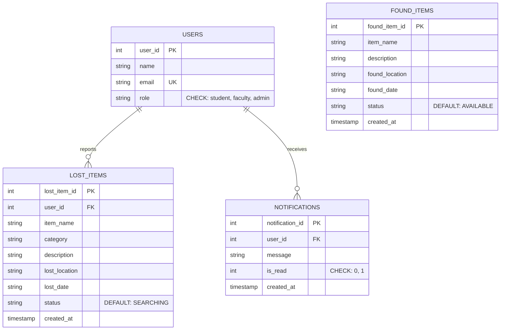

# Entity-Relationship (ER) Diagram

## Conceptual Relational Model

---

## Cardinality & Relationships

1. **`USERS 1 ──── N LOST_ITEMS`**
   - **One user** can report **zero or many** lost items.
   - **Each lost item** belongs to **exactly one** user.
   - **Foreign Key**: `lost_items.user_id` &rarr; `users.user_id` (`ON DELETE CASCADE`).

2. **`USERS 1 ──── N NOTIFICATIONS`**
   - **One user** can receive **zero or many** automated notifications.
   - **Each notification** is addressed to **exactly one** user.
   - **Foreign Key**: `notifications.user_id` &rarr; `users.user_id` (`ON DELETE CASCADE`).

3. **`FOUND_ITEMS`**
   - Standalone campus inventory entity tracking items turned in to the Lost & Found desk.
